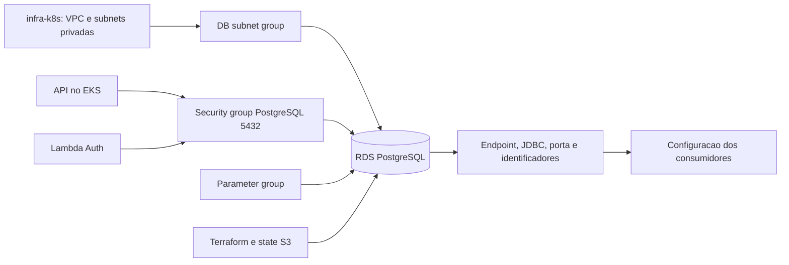

# oficina-dgcar-infra-db

Provisiona a camada de dados da Oficina DGCar em homolog e prod: Amazon RDS PostgreSQL, subnet group, security group, parameter group e políticas de armazenamento, backup e exclusão. Não executa migrations nem aplica a API; o schema é mantido pelo Flyway no repositório da aplicação.

## Tecnologias e arquitetura

Terraform, provider AWS, RDS PostgreSQL 16, VPC/subnets privadas, security groups, backend S3 com lockfile e GitHub Actions.



A API e a Lambda precisam tanto das credenciais de banco quanto da conectividade de rede. O RDS não é público.

## Entradas e outputs

| Entrada Terraform | Origem |
|---|---|
| `environment` | `homolog` ou `prod`; informe explicitamente, pois o padrão do módulo é `academic` |
| `vpc_id`, `private_subnet_ids` | Infraestrutura Kubernetes; subnets como lista de strings |
| `allowed_security_group_ids` | IDs autorizados, parâmetro textual; o código extrai IDs `sg-...` e remove duplicados |
| `auth_lambda_security_group_id` | Security group da Lambda |
| `db_username`, `db_password` | Credenciais do RDS; senha sensível |
| `db_instance_class`, `db_storage_type`, `backup_retention_period` | Sobrescritos pelo workflow por ambiente |
| `deletion_protection`, `skip_final_snapshot` | Política de exclusão aplicada pelo workflow |

A variável textual de security groups aceita o conteúdo extraído tanto do formato separado por vírgulas quanto da representação JSON fornecida pela orquestração. `private_subnet_ids`, por sua vez, é uma lista Terraform e deve receber JSON válido em `TF_VAR_private_subnet_ids`.

Os [outputs](terraform/outputs.tf) são `rds_endpoint` (host sem porta), `rds_port`, `db_name`, `spring_datasource_url`, `rds_security_group_id`, `rds_instance_identifier`, `db_subnet_group_name` e `db_parameter_group_name`.

O workflow atual faz o apply, mas não contém etapa de publicação automática dos secrets `DB_*` ou `SPRING_DATASOURCE_*` nos consumidores. Configure esses valores nos environments da Lambda e da API a partir dos outputs e das credenciais utilizadas. Não confunda existência de output Terraform com distribuição automática entre repositórios.

## Configuração efetiva por ambiente

| Parâmetro | Homolog | Prod |
|---|---|---|
| Classe | `db.t3.micro` | `db.t3.micro` |
| Storage | `gp2` | `gp2` |
| Retenção automática | 0 dias | 0 dias |
| Deletion protection no apply | `false` | `true` |
| Skip final snapshot no apply | `true` | `false` |

Os parâmetros são definidos pelo workflow, não por arquivos `.tfvars` de ambiente. Os demais padrões do módulo incluem PostgreSQL 16, storage inicial de 20 GiB com crescimento até 30 GiB, `multi_az=false`, criptografia habilitada e porta 5432. Portanto, a configuração de prod não deve ser descrita como Multi-AZ.

As janelas são `03:00-04:00` UTC para backup e `sun:04:00-sun:05:00` UTC para manutenção. O parameter group registra consultas a partir de 1000 ms. `apply_immediately=true` e atualização automática de versão minor estão habilitados. Backups automáticos não estão habilitados com retenção zero. O snapshot final de prod permanece habilitado no destroy.

A proteção contra exclusão de prod é efetiva no recurso criado. A remoção central exige confirmação e prepara a instância explicitamente antes do destroy. Em prod, sincroniza os atributos de exclusão e utiliza snapshot final com identificador único por execução. Esse procedimento é exclusivo do destroy manual.

## Validação local

Pré-requisitos: Terraform compatível com o projeto (a CI usa 1.15.8), acesso ao registry de providers e Git. Na raiz:

```sh
terraform -chdir=terraform fmt -check -recursive
terraform -chdir=terraform init -backend=false
terraform -chdir=terraform validate
```

Esses comandos não aplicam recursos. Para um plano do ambiente real, configure credenciais AWS e todas as entradas, inicialize o backend S3 correto e execute `terraform plan`. `-backend=false` não transforma um plano real em teste isolado do state.

O backend usa `use_lockfile=true`; bucket e chave são fornecidos por `TF_STATE_BUCKET` e `TF_STATE_KEY`. Homolog e prod usam states separados. Não versione credenciais, `.tfvars` com valores reais ou state.

O bucket do state deve ter criptografia e controle de acesso configurados. O lock protege contra operações concorrentes; ele não substitui a proteção do conteúdo do state, que pode conter dados sensíveis.

## Conexão e dimensionamento

A API utiliza o output `spring_datasource_url` como URL JDBC. Usuário e senha devem ser configurados como secrets no ambiente de execução; a Lambda utiliza os parâmetros de conexão `DB_*`. A conexão depende também da autorização dos security groups e do acesso à rede privada do RDS.

O dimensionamento atual, com storage inicial de 20 GiB, crescimento até 30 GiB e `multi_az=false`, atende ao ambiente definido neste projeto. Uma implantação produtiva com outros requisitos de carga e disponibilidade exige avaliar a classe da instância, o uso de Multi-AZ e a retenção de backup. A configuração atual de prod permanece a da tabela acima.

As aprovações de operação dependem das regras configuradas no GitHub Environment de cada ambiente.

## CI, apply e orquestração

O workflow [Managed Database Terraform](.github/workflows/terraform.yml) executa:

| Gatilho | Comportamento |
|---|---|
| PR para `homolog` ou `main` | Formatação, init, validate e plano sem refresh, em checkout sem backend remoto |
| Merge nessas branches, alterando Terraform, workflow ou `scripts/ci/**` | Validação e solicitação automática de atualização na fila central |
| Dispatch com `action=plan` | Validação e plano sem refresh; não aplica |
| Dispatch com `action=apply` | Valida e solicita atualização ao coordenador de infra-k8s |
| Remoção | Somente pelo workflow central de destroy, com confirmação explícita |

Para aplicar: **Actions → Managed Database Terraform → Run workflow**, escolha referência, `action=apply` e `environment=homolog` ou `prod`.

Os workflows **Provisionar Ambiente Homolog/Prod** de infra-k8s também disparam `terraform.yml` com `action=apply`. Primeiro provisionam a rede, depois o banco; após obter o security group da Lambda, repetem o apply do banco para autorizar essa origem. Após um merge com alterações relevantes, essa mesma fila recebe automaticamente a atualização isolada do banco, sem executar o provisionamento completo.

Secrets necessários ao apply: `AWS_ACCESS_KEY_ID`, `AWS_SECRET_ACCESS_KEY`, `AWS_REGION`, `TF_STATE_BUCKET`, `TF_STATE_KEY`, `VPC_ID`, `PRIVATE_SUBNET_IDS`, `ALLOWED_DB_SECURITY_GROUP_IDS`, `DB_USERNAME`, `DB_PASSWORD` e `AUTH_LAMBDA_SECURITY_GROUP_ID` quando a Lambda já existe. `GH_AUTOMATION_TOKEN` permite solicitar a atualização e verificar a execução pai antes do acesso à AWS. O apply não publica outputs automaticamente nos consumidores.

Após o apply, consulte os outputs no state do ambiente e valide a conexão pelos consumidores autorizados. A validação local do Terraform não comprova conectividade da API ou Lambda ao banco. Os procedimentos completos ficam em [infra-k8s](https://github.com/techdgconsulting/oficina-dgcar-infra-k8s).

## Contratos das APIs consumidoras

Este repositório não expõe API HTTP própria.

- [Swagger da API local](http://localhost:8080/swagger-ui.html) e [OpenAPI JSON local](http://localhost:8080/api-docs).
- Homolog/prod: `${OFICINA_PUBLIC_BASE_URL}/swagger-ui.html` e `${OFICINA_PUBLIC_BASE_URL}/api-docs`, usando a base do Gateway do ambiente.
- [Collection Postman](https://github.com/techdgconsulting/oficina-dgcar-api/blob/homolog/postman/Oficina-DGCar-Tech-Challenge-Fase-3.postman_collection.json).
- [Contrato da autenticação Lambda](https://github.com/techdgconsulting/oficina-dgcar-auth-lambda/blob/homolog/src/handler.js).

A arquitetura e as decisões ficam na [documentação central](https://github.com/techdgconsulting/oficina-dgcar-docs). A origem da extração está em [ORIGEM_HISTORICA.md](ORIGEM_HISTORICA.md).

O worker aplica o plano salvo somente após validação. Qualquer remoção ou substituição bloqueia a atualização e exige revisão. States, locks e secrets permanecem separados por ambiente; `homolog` usa a branch `homolog` e `prod` usa `main`. Os campos `orchestrated`, `parent_run_id` e `source_sha` pertencem ao coordenador. PRs para `main` devem conter o histórico de homolog. Consulte a [ADR-020](https://github.com/techdgconsulting/oficina-dgcar-docs/blob/homolog/docs/adr/ADR-020-promocao-e-deploy-automatico.md).
